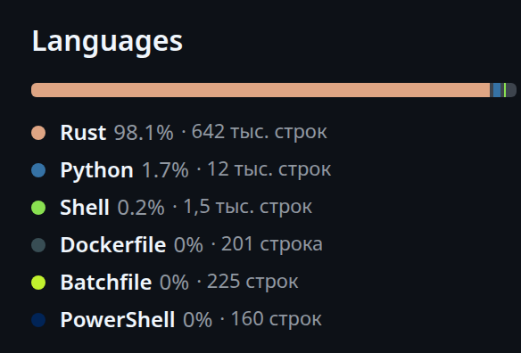

# GitHub LOC — сколько всего строк кода

Расширение для Chromium-браузеров (Chrome, Chromium, Brave, Edge, Helium) и Firefox.
На странице репозитория GitHub под виджетом «Languages» показывает **общее число строк кода**:
сначала мгновенную оценку по байтам, а по кнопке — точный подсчёт потоковым разбором архива.



## Что умеет

* **Оценка за доли секунды** — по байтам языков из `GET /repos/{owner}/{repo}/languages`
  (средняя длина строки на язык, поэтому это именно оценка — с «≈»).
* **Точный подсчёт** — скачивает tarball репозитория и считает строки потоково:
  gzip → tar → построчный разбор, ничего не распаковывая на диск и не буферизуя файлы целиком.
* **Разбивка по языкам** — рядом с каждым языком в списке GitHub и в раскрывающейся таблице.
* **Прогресс и отмена** — видно, сколько скачано и сколько файлов обработано; можно прервать.
* **Кэш** — точные результаты хранятся 7 суток, оценки — 24 часа, метаданные репозитория — 6 часов.
* **Приватные репозитории** — через токен или (по умолчанию) через вашу сессию github.com.
* **Учитывает только «свой» код** — выкидывает `node_modules`, `vendor`, `dist`, lock-файлы,
  минифицированное, бинарники и файлы больше лимита.
* Светлая и тёмная тема, русский интерфейс, никаких внешних зависимостей и сборки.

## Установка

### Chromium / Chrome / Brave / Edge / Helium

Вариант 1 — «по-настоящему», во все профили браузера:

```bash
./tools/install-chromium.sh      # соберёт CRX3 и положит его в профиль Chromium
```

Скрипт кладёт подписанный CRX в `~/.local/share/github-loc/` и прописывает его в
`~/.config/chromium/External Extensions/` — Chromium устанавливает такое расширение
для всех профилей при следующем запуске (браузер нужно один раз перезапустить).

Вариант 2 — вручную, без скрипта:

1. `node tools/build.mjs` — соберёт `dist/github-loc/`.
2. Откройте `chrome://extensions/`, включите «Режим разработчика».
3. «Загрузить распакованное расширение» → папка `dist/github-loc`.

Вариант 3 — запуск браузера сразу с расширением:

```bash
chromium --load-extension="$PWD/dist/github-loc"
```

### Firefox

Firefox грузит MV3-расширения как временные: `about:debugging` → «Этот Firefox» →
«Загрузить временное дополнение» → выберите `manifest.firefox.json`.

## Настройки

| Настройка | По умолчанию | Что делает |
|---|---|---|
| Оценка сразу при открытии | вкл | Показывать оценку, не дожидаясь нажатия кнопки |
| Строки рядом с каждым языком | вкл | Подписи `· 812 тыс. строк` в списке языков |
| Считать пустые строки | вкл | Учитывать пустые строки в итоге |
| Считать комментарии | вкл | Учитывать целые строки-комментарии |
| Лимит архива | 120 МБ | По сжатым байтам; при превышении точный подсчёт останавливается, оценка остаётся |
| Пропускать файлы больше | 5 МБ | Такие файлы не считаются (обычно сгенерированные) |
| Токен GitHub | пусто | Необязателен: даёт 5000 запросов/час и доступ к приватным репозиториям |
| Входить автоматически | вкл | Использовать текущую сессию github.com вместо токена |

Расширение **не читает cookies** и не запрашивает разрешение `cookies`: запросы к
`api.github.com` просто идут с `credentials: 'include'`, поэтому браузер сам прикладывает
вашу сессию. Если сессии нет — работает анонимно (60 запросов/час).

## Как считается

Семантика зафиксирована в [SPEC.md](SPEC.md) (раздел 2.4) и покрыта тестами:

* переводы строк: `\n`, `\r\n`, одиночный `\r`;
* `lines` — число строк; файл без завершающего перевода строки не теряет последнюю строку;
  пустой файл — 0 строк;
* `blank` — пустые строки, `comment` — строки, начинающиеся с токена комментария языка,
  `code` — остальные; при настройках по умолчанию `lines = blank + comment + code`;
* язык определяется по имени файла (включая `Dockerfile`, `Makefile`, `CMakeLists.txt`,
  `.d.ts` → TypeScript);
* «текстовость» проверяется по содержимому: NUL-байт в первых 8 КБ — бинарник;
* tar-парсер поддерживает ustar (включая `prefix`-поле), pax (`x`/`g`), GNU LongLink (`L`),
  base-256 размеры; файл целиком в память не читается.

## Разработка

Нужен Node.js ≥ 20, ничего больше — зависимостей нет.

```bash
npm test                              # 20 тестов движка (без сети)
node tools/count-repo.mjs repo.tar.gz # посчитать локальный архив
curl -sL https://codeload.github.com/owner/repo/tar.gz/HEAD \
  | node tools/count-repo.mjs -       # посчитать репозиторий потоком
node tools/e2e-browser.mjs            # e2e: headless Chromium + живой github.com
node tools/build.mjs                  # дистрибутив в dist/
node tools/make-crx.mjs               # подписанный CRX3
```

Устройство:

```
manifest.json          MV3-манифест (key — фиксированный id расширения)
src/background.js      service worker: сеть, кэш, подсчёт, протокол сообщений
src/content.js         поиск виджета Languages и панель под ним
src/content.css        стили панели на CSS-переменных GitHub
src/popup.*            настройки, статус входа, статистика кэша
src/loc/tar.js         потоковый парсер tar
src/loc/count.js       инкрементальный счётчик строк + обход архива
src/loc/lang.js        таблица языков, байт/строка, определение языка
src/loc/ignore.js      правила исключений и детект бинарников
src/loc/estimate.js    оценка по байтам
src/loc/format.js      форматирование чисел, плюрализация, разбор URL
src/loc/settings.js    настройки по умолчанию и их нормализация
tests/                 node:test + генератор tar (pax/GNU/base-256)
tools/                 сборка, установка, e2e, CLI
verify/                независимый оракул на Python и отчёт о проверке
```

## Проверка

* `npm test` — 20 тестов движка, включая сквозной подсчёт сгенерированного `tar.gz`
  с известным ответом, pax/GNU-длинные пути, обрезанный архив и отмену.
* `node tools/e2e-browser.mjs` — 12 проверок в реальном headless Chromium: расширение
  загружается, панель появляется на живом github.com, точный подсчёт совпадает с эталоном
  фикстуры, разбивка по языкам сходится, popup читает настройки, исключений нет.
* `verify/oracle.py` — независимая реализация правил SPEC на Python (stdlib), которой
  сверялись числа движка на реальных репозиториях. Подробности и найденные расхождения —
  в [verify/REPORT.md](verify/REPORT.md) и [verify/METHOD.md](verify/METHOD.md).

## Разрешения

| Разрешение | Зачем |
|---|---|
| `storage` | кэш результатов и настройки |
| `https://github.com/*` | вставить панель в страницу репозитория |
| `https://api.github.com/*` | метаданные, байты языков, tarball |
| `https://codeload.github.com/*` | публичные архивы без авторизации |

Токен (если указан) уходит только на `api.github.com`. Никакой аналитики и сторонних доменов.

## Лицензия

MIT — см. [LICENSE](LICENSE).